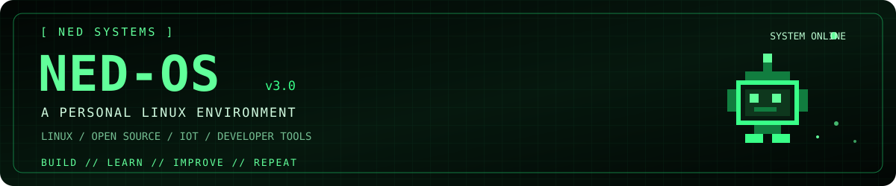

<!-- NED-OS // GitHub profile -->

 

---

## `whoami`

I'm Edwin, a Computer Science and Engineering student at **FISAT**. I like understanding how systems work and turning ideas into practical projects.

- **Building:** [NED-OS](https://github.com/Edwinshajan2006/Ned-OS), my Linux customization and developer environment project
- **Exploring:** Linux, open source, web development, machine learning, IoT and embedded systems
- **Community:** Technical Team Member – Execom, FFSC

## `toolkit`

## `selected_projects`

<table>
  <tr>
    <td width="50%" valign="top">
      <h3><a href="https://github.com/Edwinshajan2006/Ned-OS">NED-OS</a></h3>
      
A personalized Linux environment with terminal workflows, desktop customization and system utilities.

      Linux · Fedora · Shell
    </td>
    <td width="50%" valign="top">
      <h3><a href="https://github.com/Edwinshajan2006/SPAM-DETECTION">SMS Spam Detection</a></h3>
      
An SMS classification project using TF-IDF features and a Linear SVM model.

      Python · Machine Learning · scikit-learn
    </td>
  </tr>
  <tr>
    <td width="50%" valign="top">
      <h3><a href="https://github.com/Edwinshajan2006/SMART-FRIDGE-MANAGER">Smart Fridge Tracker</a></h3>
      
An IoT-focused project for tracking items and managing expiry information.

      IoT · Web Development
    </td>
    <td width="50%" valign="top">
      <h3><a href="https://github.com/Edwinshajan2006/Arduino-projects-">Arduino Projects</a></h3>
      
A collection of electronics and embedded-systems experiments.

      Arduino · Embedded Systems
    </td>
  </tr>
</table>

<a href="https://github.com/Edwinshajan2006?tab=repositories">Explore all repositories →</a>

## `github_activity`

 

## `contribution_grid`

---

<code>BUILD // LEARN // IMPROVE // REPEAT</code>

