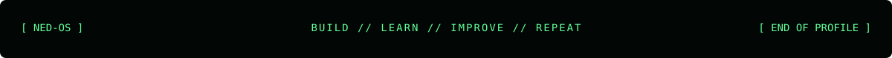

<!-- NED-OS // GitHub profile -->

---

## `whoami`

I'm Edwin, a Computer Science and Engineering student at **FISAT**. I like understanding how systems work and turning ideas into practical projects.

- **Building:** [NED-OS](https://github.com/Edwinshajan2006/Ned-OS), my Linux customization and developer environment project
- **Exploring:** Linux, open source, web development, machine learning, IoT and embedded systems
- **Community:** Technical Team Member – Execom, FFSC

## `toolkit`

## `selected_projects`

<table>
  <tr>
    <td width="50%" valign="top">
      <h3><a href="https://github.com/Edwinshajan2006/Ned-OS">NED-OS</a></h3>
      
A terminal-first Fedora environment with system utilities, diagnostics, network controls and desktop customization.

      Linux · Fedora · Shell
    </td>
    <td width="50%" valign="top">
      <h3><a href="https://github.com/Edwinshajan2006/SPAM-DETECTION">SMS Spam Detection</a></h3>
      
SMS classification using TF-IDF features and a Linear SVM model.

      Python · NLP · scikit-learn
    </td>
  </tr>
  <tr>
    <td width="50%" valign="top">
      <h3><a href="https://github.com/Edwinshajan2006/SMART-FRIDGE-MANAGER">Smart Fridge Manager</a></h3>
      
A web application for tracking food items, expiry dates and quantities.

      React · Vite · Supabase · Firebase
    </td>
    <td width="50%" valign="top">
      <h3><a href="https://github.com/Edwinshajan2006/portfolio">Personal Portfolio</a></h3>
      
A responsive portfolio showcasing software, Linux and embedded-systems work.

      HTML · CSS · JavaScript
    </td>
  </tr>
  <tr>
    <td width="50%" valign="top">
      <h3><a href="https://github.com/Edwinshajan2006/Arduino-projects-">Arduino Projects</a></h3>
      
Embedded-systems experiments covering ESP32, OLED displays, Bluetooth audio and hardware prototypes.

      Arduino · ESP32 · Embedded Systems
    </td>
    <td width="50%" valign="top">
      <h3><a href="https://github.com/Edwinshajan2006/JAVA-FOR-COMPUTER-NETWORKS">Java Computer Networks Lab</a></h3>
      
Java implementations of TCP and UDP client-server programming exercises.

      Java · TCP · UDP · Networking
    </td>
  </tr>
</table>

<a href="https://github.com/Edwinshajan2006?tab=repositories">All repositories →</a>

## `github_activity`

 

---

<code>BUILD // LEARN // IMPROVE // REPEAT</code>

